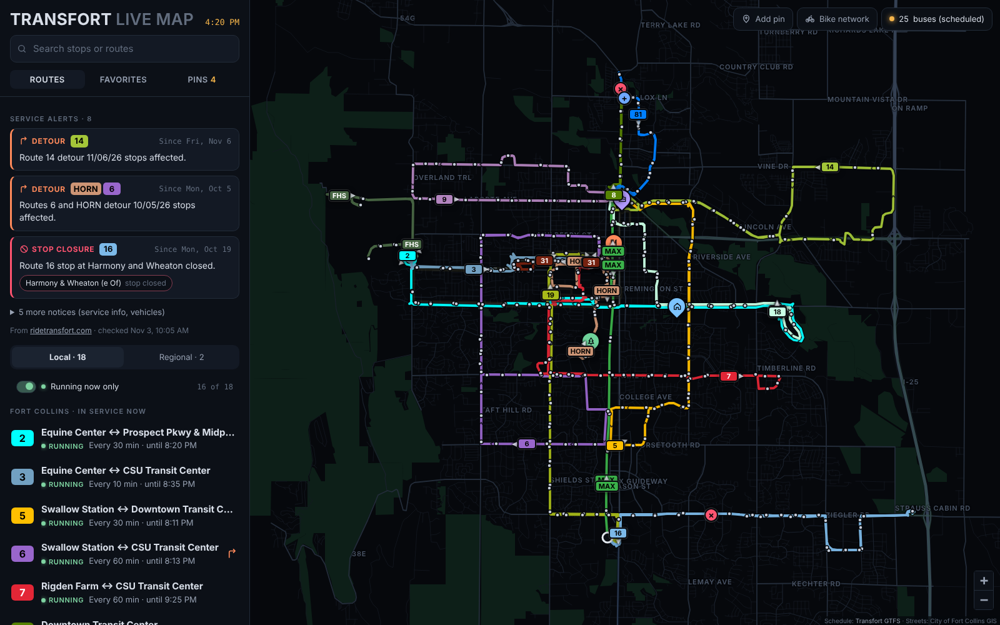
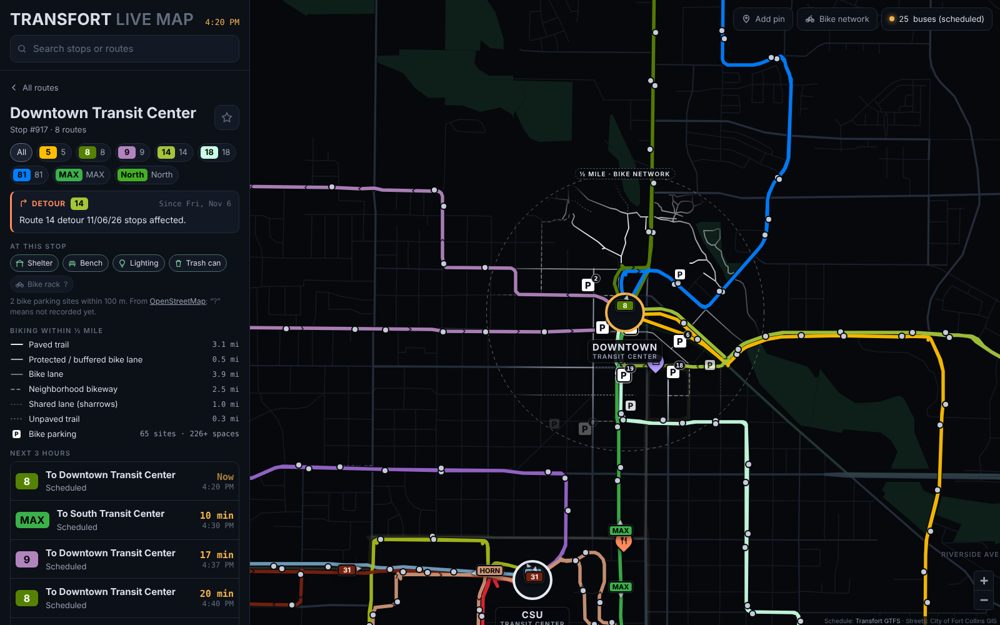
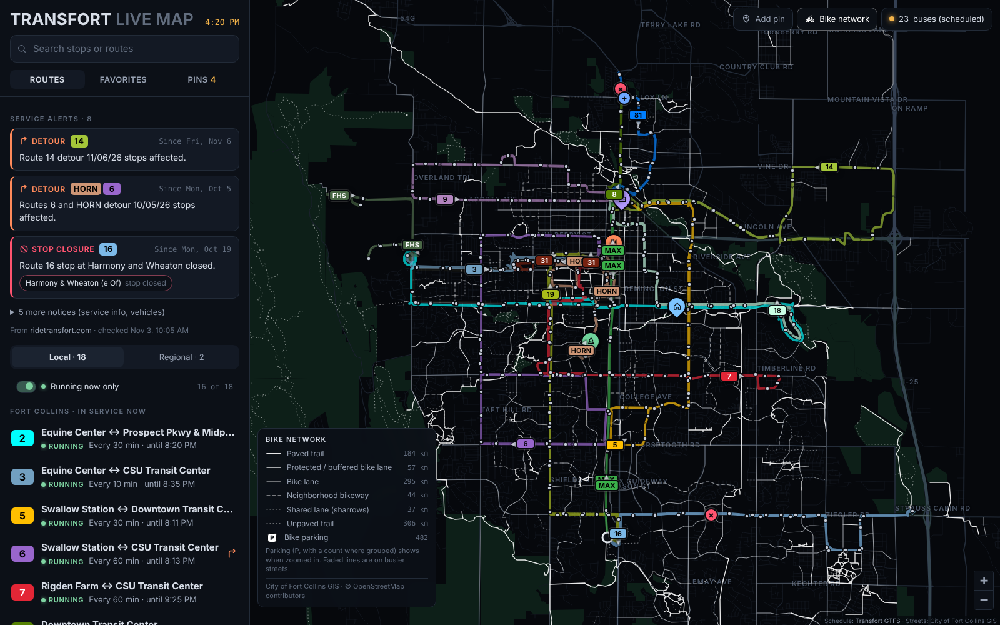
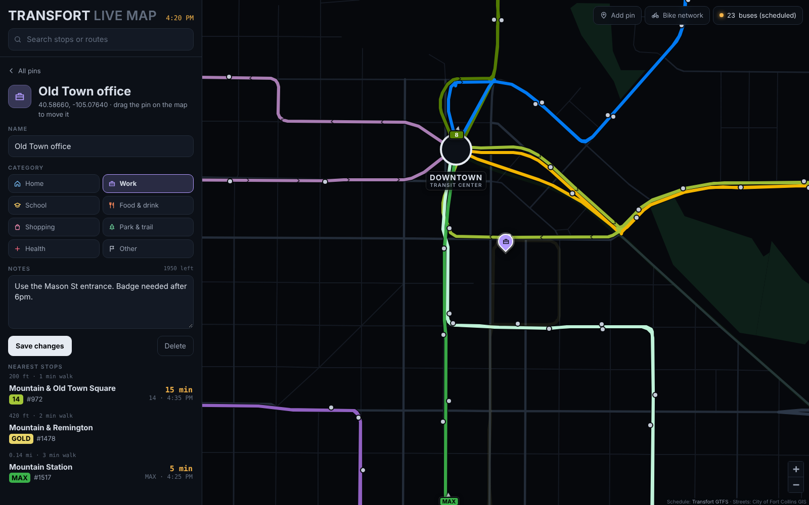

# Transfort Live Map

**A dark-theme transit map for Fort Collins, Colorado — GIS and schedule processing in Python, rendered in the browser.**

**[▶ Open the live map](https://RobertLOwens.github.io/transfort-live-map/)** &nbsp;·&nbsp; works on desktop and phones, no install

[](https://github.com/RobertLOwens/transfort-live-map/actions/workflows/pages.yml)
[](https://github.com/RobertLOwens/transfort-live-map/actions/workflows/tests.yml)



| Stop board + ½-mile bike vignette | Bike network layer | Custom pins with nearest stops |
|---|---|---|
|  |  |  |

## What it shows off

- **GTFS processing** (pandas): 172k stop times compressed to 34 trip patterns, service calendars resolved per day in
  America/Denver time, a second agency's feed (CDOT Bustang) merged in with prefixed ids.
- **Computational geometry** (shapely, geopandas, scipy, pyproj): a corridor network that bundles routes sharing a street
  into parallel subway-map lines, peel-off ordering that cut line crossings by ~40%, schematic transit-center hubs, and
  one-way detection from directional GTFS shapes — all in a projected CRS (UTM 13N) so every tolerance is in metres.
- **Data integration**: City of Fort Collins GIS shapefiles (streets, natural areas, bike facilities, trails),
  OpenStreetMap (bike parking, stop amenities matched to GTFS stops), and a BeautifulSoup scraper for rider alerts,
  with a JavaScript port tested for parity against the Python.
- **Front end without a framework**: Leaflet + vanilla JS, a single self-contained HTML file, profiled and tuned
  (diffed SVG stop layer, canvas bike layer, cached clock reads).

## Features

- Map of every route, drawn from GTFS shapes over a vector basemap built from City of Fort Collins street centerlines
- Click a route (on the map or in the list) for its stop sequence, direction toggle, frequency, span and live countdowns
- Click a stop for a departure board (next 3 hours, filter by route) and a departures-by-hour chart
- Scheduled bus positions that glide along each route's shape (animated by the clock between 4-second fleet refreshes), with a small chevron showing each bus's heading
- Local / Regional selector: Transfort's in-town routes, or the regional services (Transfort FLEX to Boulder and CDOT's Bustang North Line to Denver), with town boundaries for context along the I-25 corridor
- "Running now" filter (the default): the map and list show only routes in service at this moment, with the rest as faint outlines; every route carries a status note (running until 10:56 PM, last trips, or when it next starts) and the choice is remembered per browser
- Bike network layer (toggle), drawn in thin pure white (facility types told apart by weight, opacity and dash rather than colour, so nothing clashes with a route colour) under the bold, outlined bus routes, with bike parking grouped into white “P” markers carrying a count: the City's bike lanes, protected lanes, neighborhood bikeways, sharrows and paved/unpaved trails, plus OpenStreetMap bike parking (capacity, covered, rack type)
- Selecting a stop opens a half-mile vignette of the bike network around it (full strength inside, fading at the edge) and lists the miles of each bike facility type and the bike parking within that radius
- Every stop is clickable on the map, with a larger invisible tap target, hover highlight and a name label when selected
- Stop details: shelter, bench, lighting, trash can and bike rack from OpenStreetMap, matched to Transfort stops by stop number, plus bike parking within 100 m
- Favorite routes and stops (saved in the browser)
- Custom pins: drop your own places (home, work, a café…) with a category and notes, see the nearest stops and next bus

## How it works

1. **`pipeline/build.py`** reads the GTFS feed(s) and City GIS layers and writes compact JSON to `web/data/`
   (schedule, bundled route geometry, basemap, bike network). It runs locally because it needs the raw shapefiles.
2. **`pipeline/bundle.py`** inlines that data, the CSS and the JS into one HTML file.
3. **GitHub Actions** (`.github/workflows/pages.yml`) re-runs the bundle step on every push to `main` and publishes the
   result to GitHub Pages; `tests.yml` runs the scraper tests and the Python/JS parity check.
4. **In the browser**, `web/app.js` lays out the bundled lines in screen space at every zoom (Douglas–Peucker cleanup,
   filleted corners, miter offsets per slot), animates scheduled bus positions, and computes departures from the
   delta-encoded trips. Arrival times are **schedule-based** (Transfort has no public real-time feed).

The sections below go deeper on each step.

## Pipeline

```
raw GTFS zip ──► pipeline/gtfs.py ──► schedule.json   routes, stops, trip patterns,
                                                     delta-encoded trip times, calendar
             └─► pipeline/geo.py  ──► routes.geojson  shape variants dissolved per route
                                                     (unary_union + linemerge), simplified in UTM 13N
street + natural-area shapefiles ──► basemap.json     clipped to the network, dissolved by
                                                     street class, label points for arterials
web/ (HTML/CSS/JS + Leaflet) ──► pipeline/bundle.py ──► dist/transfort-map.html (single file)
```

Notable choices:

- **Projected CRS for geometry.** Shapes are simplified and measured in EPSG:26913 (UTM 13N) so tolerances are in metres, then reprojected to WGS84 and rounded to 5 decimals (~1 m).
- **Compact schedule.** 172k stop_times rows become 34 unique stop patterns plus one row per trip: `[pattern, service, start_min, Δmin, Δmin, …]`. The whole schedule ships in ~0.5 MB of JSON.
- **Correct "today".** Service is resolved per date from `calendar.txt` + `calendar_dates.txt` (holidays, CSU breaks) in America/Denver time, and yesterday's after-midnight trips are included.
- **Subway-map line bundling** (`pipeline/bundling.py`). Routes are snapped onto a shared *corridor network*: every 8 m sample joins an existing node within 30 m that runs parallel (sideways only, never along the street), or starts a new one. Routes on the same street — even on opposite curbs — land on the same node chain, and a route's own outbound/inbound pair collapses onto one centreline (with a wider 48 m reach, so divided roads like Harmony merge too). Lines are then ordered per *run* (a stretch with the same set of routes), decided once along the corridor's reference route so every member agrees. Each member gets a peel-off score — how far left/right it strays from the corridor beyond each end, nearer departures weighing more — so the route that turns left next rides on the left; partners already side by side keep their order into the next run. The browser converts slots to pixel offsets along miter normals at each zoom.
- **Schematic transit centers** (`pipeline/hubs.py`). Downtown, CSU and South Transit Centers are detected from the GTFS (stops named "Transit Center" with 3+ routes). Inside each hub's approach zone the real bus-bay loops are removed, and every serving route arrives as a spoke: a cubic Bézier that leaves the hub radially and ends tangent to the real street. A route's inbound and outbound twins share one spoke. The browser draws the hub as a station disc that follows the hub's real size but caps at ~30 px. Use `--no-hubs` to draw real geometry.
- **Smooth corners** (`web/app.js`). At every zoom each route's centreline is projected to screen pixels, cleaned of sub-pixel jitter (3-D Douglas–Peucker on x, y and slot), and each corner is filleted with a fixed pixel radius *before* the slot offset is applied, so bundled lines turn on concentric curves like a metro diagram.
- **One-way stretches** (`pipeline/oneway.py`). Where a route's two directions run on different streets (loops, one-way couplets, terminal circuits), the drawn line gets small chevrons showing travel direction. Each drawn line is resampled every 15 m and compared with the route's original GTFS shapes, which still carry direction: if both directions are about equally near, the twins were merged and the line is two-way; if only one direction is near, it's one-way. A median filter and a 150 m minimum run stop intersections from flickering, and hub spokes are always two-way. About 111 km of the network is drawn one-way.
- **Crossing metric** (`pipeline/crossings.py`). Renders the offset ribbons in metres and counts where two routes' lines intersect. On the current feed: 356 crossings with the original bundling, 323 with the corridor network and a fixed order, 234 with peel-off ordering (`--line-order fixed|smart`). Some of these are unavoidable (routes crossing at intersections). Inside shared corridors the count is 303 → 214 with smart ordering → 181 once transit centers are drawn as schematic hubs.
- **Scheduled positions.** Each pattern stores its simplified polyline plus each stop's fractional position along it (from `shape_dist_traveled`, falling back to linear referencing), so the front end can interpolate where every bus should be.

## Bike layer and stop details

`pipeline/bike.py` builds `web/data/bike.json` from:

- **City of Fort Collins GIS** Bike Facilities (on-street) and Trails (off-street). On-street segments are classed from the
  city's `EXISTINGFA` field (PBL/BBL → protected, BL → bike lane, City BR or bikeway → neighborhood bikeway, sharrows →
  shared lane), unbuilt and no-ride segments dropped, and the city's comfort rating (`BIKEMAPCLA` high/low) kept so busier
  streets draw faded. Trails open to bikes split into paved and unpaved. Segments are dissolved per class and name.
- **OpenStreetMap** via an Overpass export (`raw/osm/*.tsv`): `amenity=bicycle_parking` (nodes and areas) and
  `highway=bus_stop` with `shelter`, `bench`, `lit`, `bin`, `bicycle_parking`. OSM stops are matched to GTFS stops by
  stop number (`ref` = Transfort stop code), falling back to the nearest OSM stop within 25 m. Public bike parking within
  100 m of each stop is counted. Unrecorded tags stay unknown rather than being read as "no".

Refresh by re-running this Overpass query and saving the result as TSV (OSM data © OpenStreetMap contributors, ODbL):

```
[out:csv(::type,::id,::lat,::lon,amenity,highway,public_transport,capacity,covered,bicycle_parking,access,ref,name,shelter,bench,lit,bin,waste_basket,network,operator;true;"\t")][timeout:60];
( nwr["amenity"="bicycle_parking"](40.46,-105.17,40.66,-104.97);
  node["highway"="bus_stop"](40.46,-105.17,40.66,-104.97); );
out center;
```

### Half-mile vignette

The bike layer is drawn in its own SVG pane, and selecting a stop applies a CSS `mask-image: radial-gradient(...)` to that
pane, centred on the stop and sized from 0.5 mi in metres to pixels at the current zoom. The mask is recomputed whenever
Leaflet redraws the layer, so it stays locked to the stop through pans and zooms. With the bike layer switched off only
the vignette shows; with it on, the rest of the network stays visible at 30%. The panel's "Biking within ½ mile" totals
are computed in the browser from the same network, counting each segment whose midpoint falls inside the circle.

### Bike parking groups and labels

Parking sites are clustered in screen space on every redraw: each site drops into a 72 px cell at the current zoom, then
groups whose markers would still touch (under 44 px apart) are merged, so a group splits apart as you zoom in and
clicking one zooms to its extent. Groups never sit on a map label: any that land inside a label's box slide out to its
nearest edge.

Map labels (transit centers, the selected stop, the "½ mile" ring) live in their own pane above the route lines on a dark
pill, and the ring label is placed by scanning the circle every 15° for the first spot at least 28 px from any drawn route.

### Custom pins

`web/pins.js` lets a rider drop their own pins: **Add pin** (or right-click / long-press the map), then give it a name, one
of eight categories (Home, Work, School, Food & drink, Shopping, Park & trail, Health, Other) and free-form notes. Each pin
lists its three nearest stops with walking distance and the next bus. The Pins tab manages them: filter by category,
show/hide them on the map, open one to edit, drag it to move, or delete it (with an inline confirm). Pins also show up in
search.

Pins are kept in `localStorage`. When the page runs as a published claude.ai artifact it also has a private per-person
store (`db` capability, `data/users/<id>/transit/pins`), so pins follow the viewer's account across devices and nobody
else, the page owner included, can read them; pins made in the browser beforehand are moved there once.

### Performance notes

Profiling zoom and pan showed two hot spots, both fixed:

- **Stops** were cleared and re-added (~900 SVG elements) on every zoom, filter change, 20 s tick and stop mouse-out,
  and each stop re-ran the route "running now" check, which re-read the Denver clock via `Intl.formatToParts`.
  Stops are now diffed (only stops whose visibility changes are added/removed, and only changed styles are written),
  the visible-route set is computed once per pass, and the local clock is cached per second. `updateStops` went from
  ~260 ms to ~22 ms over a six-zoom profile.
- **The bike network** (~520 segments) moved from SVG to a non-interactive canvas, and its line weights are only rewritten
  when the zoom factor changes. The vignette mask works the same on a canvas element.

Small interactive layers (stops, transit centers, parking) use Leaflet's SVG renderer: a Leaflet canvas
covers its whole pane and would swallow clicks meant for layers below it. The large route layer stays on canvas.

## Service alerts

Transfort posts rider alerts (detours, stop closures, notices) as an HTML table on
[ridetransfort.com/rideralerts](https://ridetransfort.com/rideralerts); there is no GTFS-Realtime alerts feed.

- `pipeline/alerts.py` scrapes that table with BeautifulSoup, merges alerts the site repeats under several routes
  ("Routes 6 and HORN detour"), classifies them (detour / closure / info / vehicle), keeps detour maps per route, and
  ties alerts to GTFS stops by stop number (`#1462`) or intersection name ("Harmony and Wheaton"), with a role per
  clause: closed, new, or affected. The result (`web/data/alerts.json`) ships with the page.
- `web/alerts.js` is the same logic in the browser. When the map is open in the Claude desktop app, the owner can press
  **Check now**: the page reads the alerts page through Claude's built-in browser, parses it, and saves the result to the
  artifact's shared store so every viewer sees the latest check. Everyone else gets the latest saved check, or the
  snapshot built in.
- `tests/` holds a saved copy of the page; `pytest tests` checks the scraper and `node tests/test_alerts.js` checks
  that the browser parser produces exactly what the Python one does.

```bash
python -m pipeline.alerts                       # fetch live → web/data/alerts.json
python -m pipeline.alerts --html saved.html     # or from a saved page
```

## Run it

```bash
pip install -r requirements.txt
python -m pipeline.build --gtfs raw/transfort_gtfs.zip \
    --add-feed BT-=raw/bustang_gtfs.zip:NRTH \
    --streets raw/Street_Centerlines/Street_Centerlines.shp \
    --natural raw/Natural_Areas/Natural_Areas.shp \
    --cities raw/Colorado_City_Boundaries/Colorado_City_Boundaries.shp \
    --bike-facilities raw/Bike_Facilities/Bike_Facilities.shp --trails raw/Trails/Trails.shp \
    --osm raw/osm/osm_bikeparking_busstops_20261105.tsv --out web/data
python -m pipeline.alerts            # rider alerts → web/data/alerts.json
python -m pipeline.bundle            # writes web/index.html + dist/transfort-map.html
python -m http.server -d web 8000    # dev server → http://localhost:8000
```

Bustang's schedule comes from CDOT's GTFS feed, published by RTD at
https://www.rtd-denver.com/files/gtfs/bustang-co-us.zip. `--add-feed` merges selected routes from a second feed
(`gtfs.merge_feeds`): every id is prefixed (`BT-`) so nothing collides, and only the stops, shapes and service calendars
those routes use come along. Routes from another agency, or longer than 30 km, are tagged regional. Transit centers
pick up other agencies' bays inside them, so Downtown Transit Center's board includes Bustang departures.

Get a fresh Transfort feed from https://ridetransfort.com/wp-content/uploads/transfort_gtfs.zip
(also listed on the Mobility Database as mdb-3521).

## Data sources and credits

| Data | Source | Used for |
|---|---|---|
| Transfort GTFS | City of Fort Collins / Transfort (ridetransfort.com) | routes, stops, schedules |
| Bustang GTFS | Colorado Department of Transportation (published by RTD) | Bustang North Line |
| Street centerlines, natural areas, bike facilities, trails | City of Fort Collins GIS open data | basemap, bike network |
| Municipal boundaries | State of Colorado open data | town context on regional routes |
| Bike parking, stop amenities | © OpenStreetMap contributors (ODbL) | bike parking, shelter / bench / lighting |
| Rider alerts | ridetransfort.com rider alerts page | detours and closures |

Raw files live in `raw/` (not committed — about 15 MB); the processed output in `web/data/` is. This is an independent
portfolio project, not an official Transfort product; check [ridetransfort.com](https://ridetransfort.com) before you ride.

## Project layout

```
pipeline/   Python: GTFS, geometry, bundling, hubs, one-way, bike, alerts, page bundler
web/        app.js (map + panel), pins.js (custom pins), alerts.js (shared alert parser), styles.css, data/
tests/      alert scraper tests + saved fixture page
docs/img/   README screenshots
.github/    Pages deploy + test workflows
```

## Next steps

- Real-time arrivals: Transfort's bus tracker is hosted at clever-web.fcgov.com (a Clever Devices system); worth asking the city whether it offers developer API access
- "Near me" stop search with the browser's location
- Trip planner (RAPTOR over the same compact patterns)
- Add more agencies — the pipeline is agency-agnostic GTFS

## License

Code: [MIT](LICENSE). Data: see the credits above.
